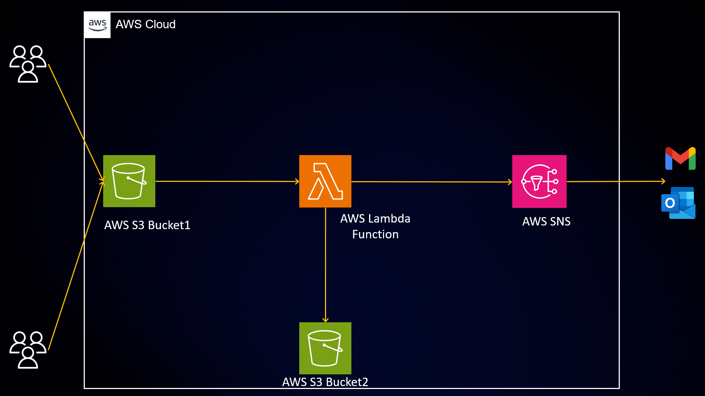
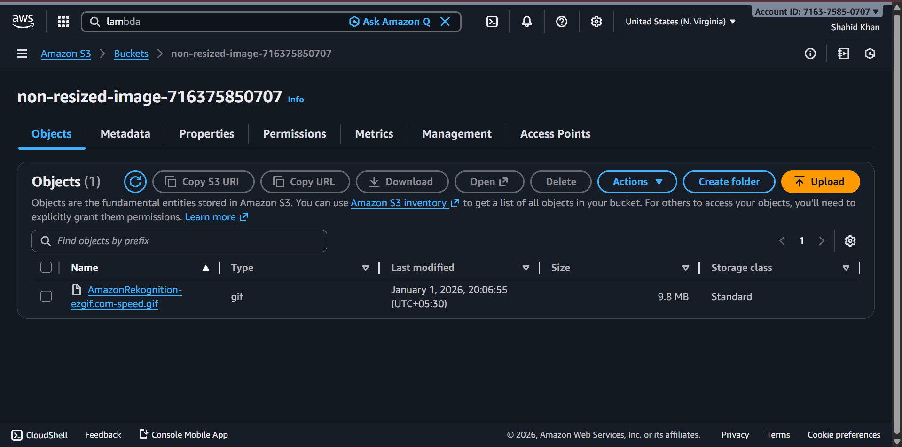
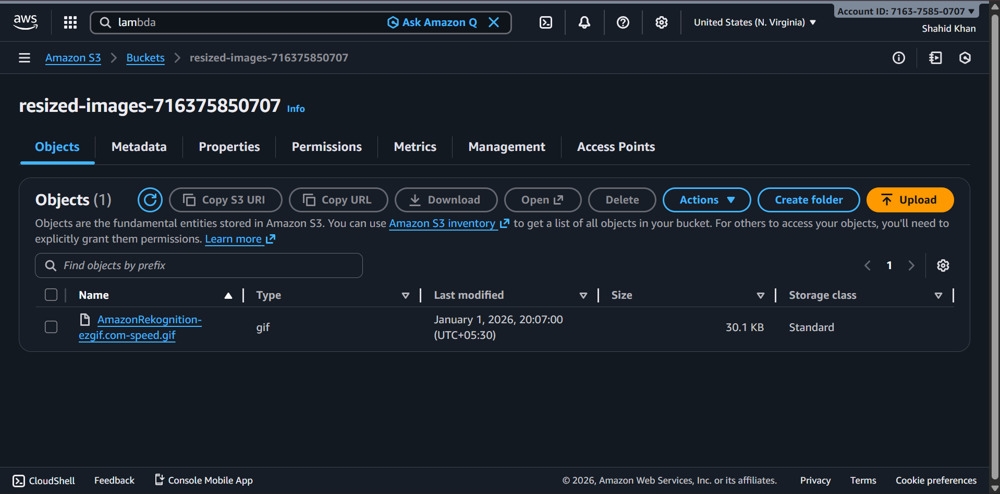
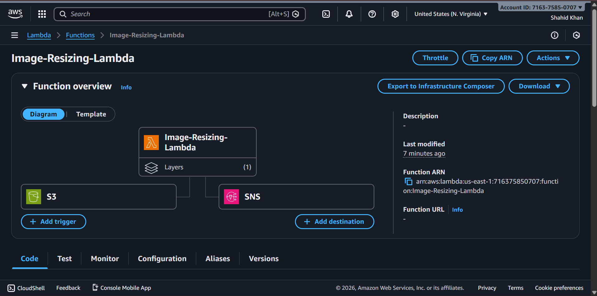
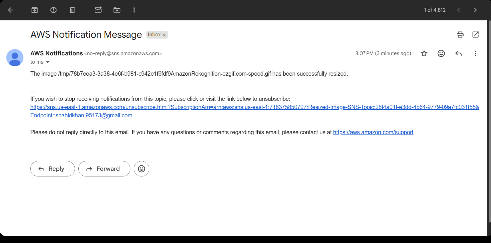

# Serverless Image Resizer on AWS (Terraform)

Upload an image to an S3 bucket → Lambda resizes it → the thumbnail lands in a second bucket → you get an email with the result and a download link.



## How it works

```
 you ──upload──▶ [S3 source bucket] ──ObjectCreated──▶ [Lambda + Pillow]
                                                          │        │
                                      resized image ◀─────┘        └──▶ [SNS] ──▶ email
                                  [S3 resized bucket]
```

| Piece | Details |
|---|---|
| Source bucket | `image-source-<account-id>` – private, encrypted, only `.jpg/.jpeg/.png/.webp` trigger Lambda |
| Resized bucket | `image-resized-<account-id>` – private, encrypted, same file name as the original |
| Lambda | Python 3.12, 512 MB, 60 s, Pillow layer, keeps aspect ratio, fixes phone-photo rotation, never upscales |
| SNS | Email on success (with a 1-hour download link) and on failure |
| IAM | Least privilege: read source, write resized, publish to this one topic, write logs |
| Logs | CloudWatch, kept for 14 days |

## Project layout

```
.
├── providers.tf             # Terraform + provider versions (no credentials!)
├── variables.tf             # All inputs, with validation
├── locals.tf                # Names derived from account ID
├── s3.tf                    # Buckets, public-access block, encryption
├── sns.tf                   # Topic + email subscription
├── iam.tf                   # Lambda role and least-privilege policy
├── lambda.tf                # Function, Pillow layer, log group, S3 trigger
├── outputs.tf               # Bucket names + handy test commands
├── src/create_thumbnail.py  # Lambda source (zipped automatically by Terraform)
├── layer/pillow-layer.zip   # Pre-built Pillow layer (Python 3.12, x86_64)
├── scripts/build_layer.sh   # Rebuilds the layer if you ever need to
├── tests/test_handler.py    # Unit tests (pytest + moto, no AWS needed)
├── terraform.tfvars.example # Copy to terraform.tfvars
├── backend.tf.example       # Optional remote state
└── .github/workflows/ci.yml # Tests + terraform fmt/validate on every push
```

## Prerequisites

- An AWS account and the [AWS CLI](https://aws.amazon.com/cli/) configured (`aws configure`, or `aws sso login`)
- [Terraform](https://developer.hashicorp.com/terraform/install) 1.5 or newer
- Your credentials stay in the AWS CLI config. **Do not put access keys in any `.tf` or `.tfvars` file.**

## Deploy

```bash
cp terraform.tfvars.example terraform.tfvars   # then edit: set notification_email
terraform init
terraform fmt
terraform validate
terraform plan
terraform apply
```

After `apply`:

1. **Open your inbox and click "Confirm subscription"** in the email from AWS. Until you do, no notifications arrive.
2. Test it (the exact command is printed as the `test_upload_command` output):
   ```bash
   aws s3 cp ./photo.jpg s3://<source_bucket>/photo.jpg
   ```
3. Within a few seconds the thumbnail appears in the resized bucket and you get an email.

Watch the logs live:

```bash
aws logs tail /aws/lambda/image-resizer-lambda --follow
```

## Configuration

Set any of these in `terraform.tfvars`:

| Variable | Default | Meaning |
|---|---|---|
| `notification_email` | *(required)* | Who gets the emails |
| `aws_region` | `us-east-1` | Deployment region |
| `project_name` | `image-resizer` | Prefix for resource names |
| `max_width` / `max_height` | `300` / `300` | Thumbnail bounding box in pixels |
| `allowed_extensions` | jpg, jpeg, png, webp (any case) | Which uploads trigger the resize |
| `lambda_memory_mb` | `512` | Lambda memory |
| `log_retention_days` | `14` | CloudWatch retention |
| `force_destroy_buckets` | `true` | Lets `terraform destroy` empty the buckets first |

## Run the unit tests (optional, no AWS needed)

```bash
python3 -m venv .venv && source .venv/bin/activate      # Windows: .venv\Scripts\activate
pip install -r requirements-dev.txt
python -m pytest -q tests
```

## Changing the code

Edit `src/create_thumbnail.py` and run `terraform apply` again. Terraform re-zips and redeploys automatically.

## Clean up

```bash
terraform destroy
```

## Troubleshooting

| Problem | Fix |
|---|---|
| No email | Confirm the SNS subscription (check spam too). Verify `notification_email`. |
| Nothing in resized bucket | Check the file extension is allowed, then read the CloudWatch logs. |
| `BucketAlreadyExists` | Change `source_bucket_prefix` / `resized_bucket_prefix`. |
| Layer/architecture errors | Deploy on x86_64 as configured, or rebuild with `scripts/build_layer.sh`. |
| Download link expired | Links last 1 hour; open the image from the resized bucket in the S3 console instead. |

## Security notes

- No credentials in code; IAM permissions are scoped to this project's buckets and topic.
- Both buckets block all public access and use server-side encryption.
- S3 can invoke the Lambda only from the source bucket in your own account.
- Terraform state (`terraform.tfstate`) can contain sensitive values. It is git-ignored; never share it. For team use, switch to the S3 backend (`backend.tf.example`).

## Cost

Well inside the AWS Free Tier for demo use. Beyond it: Lambda is roughly $0.20 per million requests plus compute time, S3 about $0.023 per GB-month, and SNS email notifications are free for the first 1,000 per month. Check current AWS pricing for your region.

## Screenshots

Screenshots of an earlier deployment (resource names there may differ slightly).

| Source bucket | Resized bucket |
|---|---|
|  |  |




## License

Provided as-is for educational and demonstration purposes.
